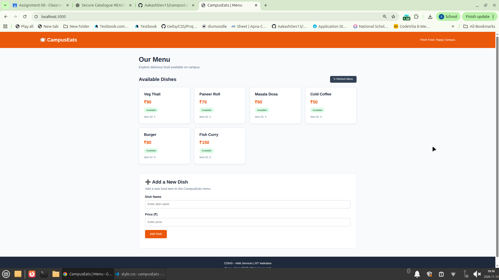
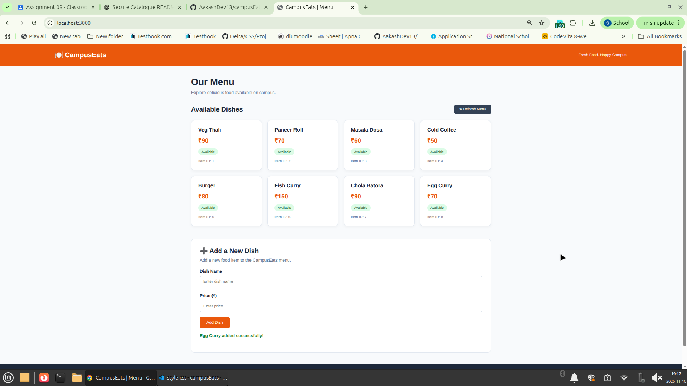

# 🍽️ CampusEats – Menu REST API

**CS543 – Web Services | Assignment 8 **

A team-based project developed using **Node.js and Express.js** to build a REST API for the CampusEats Menu Management Service.

The application allows users to retrieve menu items, fetch individual dishes by ID, and add new dishes through a simple HTML/CSS frontend.

## 📌 Project Overview

The CampusEats Menu REST API provides the following functionality:

- View all available food items.
- Retrieve a particular food item using its ID.
- Add new food items through an HTML form.
- Automatically refresh the menu after adding a new item.
- Validate incoming data and return appropriate HTTP status codes.

## 🛠️ Technologies Used

- Node.js
- Express.js
- HTML5
- CSS3
- JavaScript
- REST API
- Fetch API
- npm

## 📂 Project Structure

```text
Assignment8_CampusEats_REST_API/
│
├── server.js
├── package.json
├── package-lock.json
├── README.md
│
├── public/
│   ├── index.html
│   └── style.css
│
└── screenshots/
    ├── before.png
    └── after.png
```

## 🔗 REST API Endpoints

| HTTP Method | Endpoint | Description |
|---|---|---|
| GET | `/items` | Retrieve all menu items |
| GET | `/items/:id` | Retrieve a menu item by ID |
| POST | `/items` | Add a new menu item |

## 📋 Sample Menu Data

The application uses an in-memory JavaScript array containing initial menu records.

| ID | Item Name | Price | Availability |
|---|---|---:|---|
| 1 | Veg Thali | ₹90 | Available |
| 2 | Paneer Roll | ₹70 | Available |
| 3 | Masala Dosa | ₹60 | Available |
| 4 | Cold Coffee | ₹50 | Available |

## 📊 HTTP Status Codes

| Status Code | Description |
|---|---|
| 200 | Successful GET request |
| 201 | New menu item created successfully |
| 404 | Requested menu item not found |
| 422 | Required field or input is invalid |

## 📚 Assignment Questions and Answers

### 1. Which CampusEats service did you pick, and what are its routes?

We selected the **Menu/Catalogue Service** of CampusEats.

The implemented routes are:

- `GET /items` – Retrieves all menu items.
- `GET /items/:id` – Retrieves a particular menu item using its ID.
- `POST /items` – Creates a new menu item.

### 2. Which status codes did you return, and for which outcomes?

- **200 OK:** When menu items or a particular item are retrieved successfully.
- **201 Created:** When a new menu item is added successfully.
- **404 Not Found:** When the requested item ID does not exist.
- **422 Unprocessable Entity:** When the required name or valid price is missing.

### 3. Where did you use req.params and where req.body? Why does POST need express.json()?

- `req.params.id` is used in `GET /items/:id` to retrieve the ID from the URL.
- `req.body` is used in `POST /items` to access the data submitted by the client.
- `express.json()` is required to parse incoming JSON request bodies so that the server can access the submitted data through `req.body`.

## ⚙️ Installation and Setup

### 1. Clone the Repository

```bash
git clone https://github.com/AakashDev13/campusEats.git
```

### 2. Navigate to Assignment 8

```bash
cd campusEats/Assignment8_CampusEats_REST_API
```

### 3. Install Dependencies

```bash
npm install
```

### 4. Start the Server

```bash
node server.js
```

### 5. Open the Application

Visit:

```text
http://localhost:3000
```

## 🖥️ Screenshots

### Before Adding a New Dish



### After Adding a New Dish



## 🎥 Demonstration Video

Google Drive Video Link: **[Add your demonstration video link here]**

## 👥 Team Members

| S. No. | Name | Roll Number |
|---|---|---|
| 1 | Sonu Jha | Add Roll Number |
| 2 | Add Team Member Name | Add Roll Number |
| 3 | Add Team Member Name | Add Roll Number |

## 👨‍🏫 Course Information

- **Course:** CS543 – Web Services
- **Assignment:** 8 of 12
- **Institute:** IIIT Vadodara
- **Instructor:** Dr. Pramit Mazumdar

## ⚠️ Note

This project uses in-memory storage. Newly added menu items are lost when the server restarts.

The project is developed for academic learning and demonstrates the fundamentals of REST API development using Node.js and Express.js.

---

**CampusEats – Fresh Food. Happy Campus.**